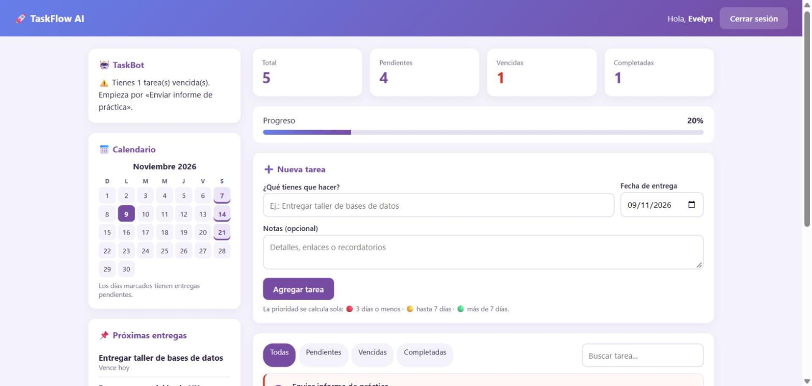

# TaskFlow AI

Aplicación web para organizar tareas académicas y personales, desarrollada con **Python, Flask y SQLite**.

Cada usuario tiene su propia cuenta y su lista de tareas, con prioridad calculada automáticamente según la fecha de entrega, un calendario con las entregas del mes y un asistente (TaskBot) que da recomendaciones según el estado real de las tareas.



---

## Funcionalidades

- **Cuentas de usuario:** registro e inicio de sesión con contraseñas cifradas.
- **Tareas completas (CRUD):** crear, editar, completar, reabrir y eliminar tareas, con notas opcionales.
- **Prioridad automática:** se recalcula cada día según la fecha de entrega.
  - 🔴 Alta: faltan 3 días o menos
  - 🟡 Media: faltan entre 4 y 7 días
  - 🟢 Baja: faltan más de 7 días
- **Filtros y búsqueda:** ver todas, pendientes, vencidas o completadas, y buscar por título.
- **Panel de progreso:** total de tareas, pendientes, vencidas, completadas y porcentaje de avance.
- **Calendario:** marca los días del mes que tienen entregas pendientes.
- **TaskBot:** avisa de tareas vencidas o que vencen hoy, y felicita cuando terminas todo.
- **Interfaz responsive:** funciona en computador, tablet y celular.
- **Mensajes claros:** confirmación antes de eliminar y avisos después de cada acción.

## Seguridad

- Contraseñas cifradas con `generate_password_hash` de Werkzeug, nunca en texto plano.
- Cada usuario solo puede ver, editar y eliminar sus propias tareas: si intenta acceder a una ajena, recibe un error 404.
- Protección **CSRF**: todos los formularios llevan un token de sesión.
- Las acciones que modifican datos usan `POST`, no enlaces `GET`.
- Consultas SQL con parámetros (`?`) para evitar inyección SQL.
- La clave de sesión se lee de la variable `SECRET_KEY`, y el modo debug solo se activa con `FLASK_DEBUG=1`.

## Tecnologías

- Python 3 y Flask
- SQLite
- HTML5, CSS3 (Grid, Flexbox, variables) y JavaScript
- Jinja2 (plantillas con herencia)
- unittest (pruebas automáticas)

## Instalación

```bash
git clone https://github.com/evelyn-escobar/taskFlow_web_app.git
cd taskFlow_web_app

python -m venv .venv
.venv\Scripts\activate        # Windows
# source .venv/bin/activate   # macOS / Linux

pip install -r requirements.txt
python app.py
```

Abre `http://127.0.0.1:5000` en el navegador. La base de datos `tasks.db` se crea sola la primera vez.

## Pruebas

```bash
python -m unittest
```

Las pruebas usan una base de datos temporal y verifican el registro, el inicio de sesión, el cifrado de contraseñas, el CRUD de tareas, los filtros, el cálculo de prioridad y que un usuario no pueda modificar las tareas de otro.

## Estructura

```plaintext
taskFlow_web_app/
├── app.py              # Rutas, lógica de tareas y seguridad
├── test_app.py         # Pruebas automáticas
├── requirements.txt
├── static/
│   └── style.css
└── templates/
    ├── base.html       # Plantilla base (avisos y scripts comunes)
    ├── login.html
    ├── register.html
    ├── index.html      # Panel principal
    ├── edit.html
    └── error.html
```

## Autora

**Evelyn Daniela Escobar** – Estudiante de Tecnología en Desarrollo de Software (UNAD).
